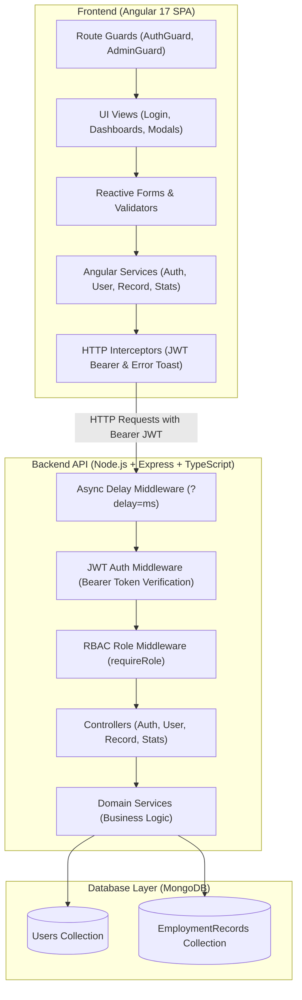
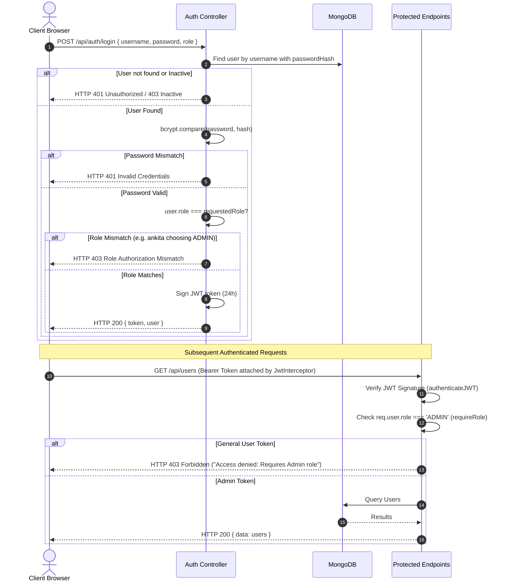

# MPloyChek Employee Verification Portal

A complete, original, production-quality full-stack Single Page Application (SPA) built for the **MPloyChek Software Intern Coding Challenge**.

The portal simulates a digital background verification and employment record management platform featuring **JWT authentication**, **Role-Based Access Control (RBAC)**, **configurable asynchronous API delays**, and a modular **Angular 17** + **Node.js/Express** + **TypeScript** + **MongoDB** architecture.

---

## Table of Contents
1. [Project Overview](#project-overview)
2. [Key Features](#key-features)
3. [Technology Stack & Rationale](#technology-stack--rationale)
4. [System Architecture](#system-architecture)
5. [Directory Structure](#directory-structure)
6. [Database Schema & Data Model](#database-schema--data-model)
7. [Authentication & RBAC Security Flow](#authentication--rbac-security-flow)
8. [Asynchronous API Delay Mechanism](#asynchronous-api-delay-mechanism)
9. [REST API Endpoints Specification](#rest-api-endpoints-specification)
10. [Demo Credentials](#demo-credentials)
11. [Installation & Setup Guide](#installation--setup-guide)
12. [Running Automated Tests](#running-automated-tests)
13. [Design Decisions & Interview Talking Points](#design-decisions--interview-talking-points)
14. [Future Enhancements](#future-enhancements)
15. [Verification Checklist](#verification-checklist)

---

## Project Overview

In background verification workflows like MPloyChek's, integrity, auditability, and clear separation of privileges are paramount. This application implements a modern portal serving two core personas:

1. **General Users (Employees)**:
   - View their personal profile, employee ID, department, and account status.
   - Inspect their personal employment verification ledger (verified, pending, under review, and rejected entries).
   - Test asynchronous loading behavior via real-time delay controls.
   - Strictly isolated to accessing **only their own** employment history.

2. **Administrators (HR & Verification Operations)**:
   - Access real-time organizational metrics (total users, active counts, verification distribution).
   - Directory management: add new users, update user records, and safely **deactivate/reactivate** accounts without losing historical employment records.
   - Filter and search users by keyword, role, and active status.
   - Inspect and audit all employee verification records with one-click approval/rejection actions.

---

## Key Features

- **Strict Role Verification at Login**: Validates credentials using `bcrypt` and verifies that the selected role in the login form matches the user's provisioned database role. For example, selecting `Admin` with general user credentials (`ankita`) is rejected with HTTP `403 Forbidden`.
- **Backend-Enforced Authorization**: Frontend controls and guards are backed by middleware checks (`requireRole('ADMIN')`). Direct API calls by General Users to Admin endpoints immediately return HTTP `403 Forbidden`.
- **Configurable Asynchronous API Delay**: Any API request can accept `?delay=ms` (e.g., `?delay=2000`), simulated via non-blocking event-loop timers and capped at 10,000ms.
- **Responsive Loading States**: Angular skeleton loaders and spinners provide visual feedback during asynchronous API requests.
- **Audit-Safe Soft Deactivation**: Admin deletion of accounts toggles `status: 'INACTIVE'` rather than permanently purging data, preserving verification audit trails.
- **Enterprise Design System**: Original, responsive SCSS layout built with Bootstrap 5 and Bootstrap Icons, complete with toasts, confirmation modals, and status badges.

---

## Technology Stack & Rationale

| Layer | Technology | Rationale |
|---|---|---|
| **Frontend Framework** | **Angular 17+** (Standalone Components) | Enterprise standard for SPAs; provides built-in dependency injection, typed Reactive Forms, RxJS observables, and client-side routing. |
| **Language** | **TypeScript 5** | Strict type safety across client and server eliminates runtime bugs and provides contract enforcement. |
| **Styling & UI** | **Bootstrap 5 + SCSS + Bootstrap Icons** | Responsive grid system, clean enterprise styling, and lightweight icons without heavy UI library overhead. |
| **Backend Runtime** | **Node.js 20+ / Express** | High-throughput asynchronous I/O and event loop; lightweight and standard for RESTful microservices. |
| **Database & ODM** | **MongoDB + Mongoose 8** | Flexible document schema modeling, populated relationships (`userId`), and atomic updates. |
| **Security & Auth** | **JWT (jsonwebtoken) & bcryptjs** | Stateless Bearer token authentication with 24-hour expiration and salted password hashing (10 rounds). |
| **Testing** | **Jest & Supertest** | Automated integration tests validating authentication, RBAC boundaries, and non-blocking timers. |

---

## System Architecture



---

## Directory Structure

```
MPloyChek Employee Verification Portal/
├── .env.example
├── .gitignore
├── package.json                   # Root orchestrator scripts
├── README.md
│
├── backend/
│   ├── .env                       # Local secrets (ignored by git)
│   ├── .env.example               # Environment template
│   ├── .gitignore
│   ├── jest.config.js             # Jest test configuration
│   ├── package.json
│   ├── tsconfig.json
│   ├── src/
│   │   ├── app.ts                 # Express app builder (CORS, JSON, routes)
│   │   ├── server.ts              # Entry point (DB connection & listener)
│   │   ├── config/
│   │   │   ├── db.ts              # MongoDB Mongoose connection handler
│   │   │   └── env.ts             # Typed environment variable loader
│   │   ├── controllers/
│   │   │   ├── auth.controller.ts
│   │   │   ├── user.controller.ts
│   │   │   ├── record.controller.ts
│   │   │   └── stats.controller.ts
│   │   ├── middleware/
│   │   │   ├── auth.middleware.ts  # JWT extraction & verification
│   │   │   ├── role.middleware.ts  # RBAC 403 authorization guard
│   │   │   ├── delay.middleware.ts # Configurable ?delay=ms handler
│   │   │   └── error.middleware.ts # Centralized JSON error handler
│   │   ├── models/
│   │   │   ├── User.ts            # User schema with hashed passwords
│   │   │   └── EmploymentRecord.ts# Verification record schema
│   │   ├── routes/
│   │   │   ├── auth.routes.ts
│   │   │   ├── user.routes.ts
│   │   │   ├── record.routes.ts
│   │   │   ├── stats.routes.ts
│   │   │   └── index.ts           # Central router aggregator
│   │   ├── services/
│   │   │   ├── auth.service.ts
│   │   │   ├── user.service.ts
│   │   │   ├── record.service.ts
│   │   │   └── stats.service.ts
│   │   └── utils/
│   │       └── seed.ts            # Seeder for demo accounts & records
│   └── tests/
│       ├── setup.ts               # Test database setup helper
│       ├── auth.test.ts           # Login & credential unit/integration tests
│       ├── authorization.test.ts  # RBAC 403 enforcement tests
│       └── records.test.ts        # Scoped data boundaries & delay tests
│
└── frontend/
    ├── angular.json               # Angular CLI workspace config
    ├── package.json
    ├── tsconfig.json
    └── src/
        ├── index.html
        ├── main.ts
        ├── styles.scss            # Global enterprise styling
        └── app/
            ├── app.component.ts   # Root container with toasts & router outlet
            ├── app.config.ts      # Angular 17 application providers
            ├── app.routes.ts      # Route declarations with guards
            ├── core/
            │   ├── guards/
            │   │   ├── auth.guard.ts
            │   │   └── admin.guard.ts
            │   ├── interceptors/
            │   │   ├── jwt.interceptor.ts
            │   │   └── error.interceptor.ts
            │   ├── models/
            │   │   ├── user.model.ts
            │   │   ├── record.model.ts
            │   │   ├── auth.model.ts
            │   │   └── stats.model.ts
            │   └── services/
            │       ├── auth.service.ts
            │       ├── user.service.ts
            │       ├── record.service.ts
            │       ├── stats.service.ts
            │       └── toast.service.ts
            ├── auth/
            │   └── login/         # Login component & quick demo chips
            ├── dashboard/
            │   ├── user-dashboard/# Employee dashboard & personal records
            │   └── admin-dashboard/# HR metrics & verification stream
            ├── users/
            │   ├── user-list/     # User table, live search & filters
            │   └── user-form-modal/# Add/edit user modal dialog
            ├── records/
            │   └── record-list/   # Verification ledger & approval actions
            └── shared/
                └── components/
                    ├── navbar/
                    ├── sidebar/
                    ├── skeleton-loader/
                    ├── confirm-dialog/
                    └── toast/
```

---

## Database Schema & Data Model

### `User` Collection
| Field | Type | Description |
|---|---|---|
| `name` | String | Full employee name |
| `username` | String | Unique, lowercased login username |
| `email` | String | Unique, lowercased email address |
| `passwordHash` | String | Salted bcrypt hash (`select: false` by default) |
| `role` | String | `'ADMIN'` or `'GENERAL_USER'` |
| `department` | String | Department (e.g., Software Engineering, QA) |
| `employeeId` | String | Unique company employee ID (e.g., `EMP-ENG-104`) |
| `status` | String | `'ACTIVE'` or `'INACTIVE'` |
| `timestamps` | Date | Automatic `createdAt` and `updatedAt` |

### `EmploymentRecord` Collection
| Field | Type | Description |
|---|---|---|
| `userId` | ObjectId | Reference to `User` document |
| `company` | String | Previous or current employer organization |
| `position` | String | Job title or role |
| `employmentType` | String | `'FULL_TIME'`, `'PART_TIME'`, `'CONTRACT'`, `'INTERNSHIP'` |
| `startDate` | String | Employment start date (`YYYY-MM-DD`) |
| `endDate` | String | Employment end date or `'Present'` |
| `verificationStatus`| String | `'VERIFIED'`, `'PENDING'`, `'IN_REVIEW'`, `'REJECTED'` |
| `verificationNotes` | String | HR audit notes and documentation check details |
| `timestamps` | Date | Automatic `createdAt` and `updatedAt` |

---

## Authentication & RBAC Security Flow



---

## Asynchronous API Delay Mechanism

A dedicated Express middleware (`delay.middleware.ts`) inspects the incoming `req.query.delay` parameter:
```typescript
export const asyncDelayMiddleware = async (req: Request, _res: Response, next: NextFunction): Promise<void> => {
  const delayParam = req.query.delay;
  if (delayParam !== undefined) {
    const parsedDelay = parseInt(String(delayParam), 10);
    if (!isNaN(parsedDelay) && parsedDelay > 0) {
      // Safe cap at 10,000 milliseconds (10 seconds)
      const cappedDelay = Math.min(parsedDelay, 10000);
      await new Promise((resolve) => setTimeout(resolve, cappedDelay));
    }
  }
  next();
};
```

### Why this is interview-relevant:
1. **Non-blocking execution**: Uses Node.js's native libuv event-loop timers (`setTimeout` wrapped in a Promise). Other concurrent requests are **not blocked**.
2. **Resource safety**: Enforces an upper threshold of 10 seconds to prevent denial-of-service degradation.
3. **Frontend responsiveness**: The Angular UI renders shimmer skeleton loaders (`<app-skeleton-loader>`) while the request is pending, proving that the single-page application remains responsive and interactive.

---

## REST API Endpoints Specification

| Method | Endpoint | Access | Delay Param | Description |
|---|---|---|---|---|
| `GET` | `/api/health` | Public | No | Server status check |
| `POST` | `/api/auth/login` | Public | Yes (`?delay=ms`) | Authenticate user & role; returns JWT |
| `GET` | `/api/auth/me` | Authenticated | Yes (`?delay=ms`) | Retrieve current user profile |
| `GET` | `/api/users` | **Admin Only** | Yes (`?delay=ms`) | Query all users (with search, role, status filters) |
| `GET` | `/api/users/:id` | **Admin Only** | Yes (`?delay=ms`) | Get single user details |
| `POST` | `/api/users` | **Admin Only** | No | Create and provision a new user |
| `PUT` | `/api/users/:id` | **Admin Only** | No | Update user profile fields |
| `PATCH`| `/api/users/:id/status`| **Admin Only**| No | Toggle user active/inactive status |
| `DELETE`| `/api/users/:id` | **Admin Only** | No | Soft deactivation of user account |
| `GET` | `/api/records` | Authenticated | Yes (`?delay=ms`) | Get records (Scoped to user; all for Admin) |
| `GET` | `/api/records/:id` | Authenticated | Yes (`?delay=ms`) | Get single record with ownership check |
| `POST` | `/api/records` | Authenticated | No | Create an employment verification record |
| `PUT` | `/api/records/:id` | Authenticated | No | Update record / verification status |
| `GET` | `/api/stats` | **Admin Only** | Yes (`?delay=ms`) | Aggregate verification and user metrics |

---

## Demo Credentials

All passwords in the database are hashed with `bcrypt` (10 rounds):

| Persona | Username | Password | Role to Select | Pre-loaded Records |
|---|---|---|---|---|
| **Administrator** | `admin` | `Admin@123` | **Administrator** | Access to all employees, metrics, and records |
| **General User** | `ankita` | `User@123` | **General User** | Infosys (Verified), Zomato (Verified), NovaTech (In Review) |
| **General User** | `rahul` | `User@123` | **General User** | Flipkart (Verified), Swiggy (Verified), FinEdge (Pending) |

> [!TIP]
> **One-Click Quick Fill**: On the login page, you can click any of the quick-fill buttons (`Admin`, `User: Ankita`, or `User: Rahul`) to automatically populate the form.

---

## Installation & Setup Guide

### Prerequisites
- **Node.js**: v18+ (tested on Node 20 / 26)
- **MongoDB**: v6.0+ running locally on port `27017` (e.g. `mongodb://127.0.0.1:27017/mploychek_db`)
- **npm**: v9+

### 1. Clone & Install Dependencies
From the repository root folder:
```bash
# Install backend dependencies
cd backend
npm install

# Install frontend dependencies
cd ../frontend
npm install
```
*(Or run `npm run install:all` directly from the project root).*

### 2. Configure Environment Variables
Copy `.env.example` to `.env` in the `backend/` directory:
```bash
cd backend
cp .env.example .env
```
Default `.env` configuration:
```env
PORT=5000
NODE_ENV=development
MONGO_URI=mongodb://127.0.0.1:27017/mploychek_db
JWT_SECRET=mploychek_jwt_super_secure_secret_intern_assessment_key_2024
JWT_EXPIRES_IN=24h
CLIENT_URL=http://localhost:4200
```

### 3. Seed Database
Populate the initial demo users and verification records:
```bash
cd backend
npm run seed
```

### 4. Run the Backend API Server
```bash
cd backend
npm run dev
```
The API server will start at **`http://localhost:5000`**.  
Verify health check at: `http://localhost:5000/api/health`.

### 5. Run the Angular Frontend
In a new terminal window:
```bash
cd frontend
npm start
```
The Angular application will launch at **`http://localhost:4200`**.

---

## Running Automated Tests

### Backend Automated Test Suite (Jest + Supertest)
Runs 13 comprehensive integration tests verifying authentication, role mismatches, 403 blocks, data boundaries, and non-blocking timers:
```bash
cd backend
npm test
```
**Test Results:**
```
PASS tests/authorization.test.ts
  Role-Based Authorization & Users API (/api/users)
    √ should return 401 Unauthorized when accessing /api/users with no token
    √ should return 403 Forbidden when General User attempts to access Admin-only /api/users
    √ should return 200 OK when Admin accesses /api/users
    √ should allow Admin to create a new user
    √ should allow Admin to deactivate a user (DELETE /api/users/:id)

PASS tests/records.test.ts
  Employment Records API (/api/records)
    √ should return ONLY own records for General User
    √ should return all records for Admin
    √ should respect the async delay query parameter (?delay=100)

PASS tests/auth.test.ts
  Authentication API (/api/auth)
    √ should successfully log in an Admin with valid credentials and ADMIN role
    √ should successfully log in a General User with valid credentials and GENERAL_USER role
    √ should reject login when user attempts to select unauthorized role (ankita requesting ADMIN)
    √ should reject login with invalid password
    √ should retrieve profile with valid JWT via GET /api/auth/me

Test Suites: 3 passed, 3 total
Tests:       13 passed, 13 total
Snapshots:   0 total
```

### Frontend Production Build
Verifies that Angular 17 compiles cleanly with zero template, typing, or routing errors:
```bash
cd frontend
npm run build
```
Output: `Application bundle generation complete.` (`dist/frontend`).

---

## Design Decisions & Interview Talking Points

If asked to explain this project during an interview, here are the key technical architectural decisions made:

1. **Why Angular 17 Standalone Components instead of classic NgModules?**
   - Standalone components reduce boilerplate, simplify dependency management (`imports: [CommonModule, ReactiveFormsModule]`), enable tree-shaking, and represent the official modern Angular paradigm.

2. **Why enforce Role matching on the Login endpoint?**
   - In enterprise security, users must declare their requested scope. If a user selects `Admin` but possesses only `GENERAL_USER` privileges, rejecting the request at the auth boundary prevents unintentional privilege assumptions.

3. **Why enforce record filtering at the database query level rather than in the service?**
   - In `RecordService.getRecords()`, general users have their query restricted to `{ userId: currentUser.id }`. Even if a malicious client alters the request or inspects network payloads, the backend **never fetches or transmits other users' data**.

4. **Why soft deactivation instead of hard SQL/MongoDB delete?**
   - Employment verification platforms are legal audit systems. Purging a user record would orphan or invalidate their historical verification certificates. Soft deactivation (`status: 'INACTIVE'`) retains data integrity while revoking access.

5. **How does the Async Delay Middleware demonstrate Node.js asynchronous architecture?**
   - By using `await new Promise(resolve => setTimeout(resolve, delay))`, the thread is returned to Node's libuv event loop. Other concurrent requests continue to be served without bottlenecking, demonstrating true asynchronous non-blocking I/O.

---

## Future Enhancements
- **Document Uploads**: Attach scanned PDF relieving letters and salary slips to verification records using AWS S3 or GridFS.
- **Automated Verification Webhooks**: Integration with third-party background verification APIs and automated email verification tokens for past employers.
- **Two-Factor Authentication (2FA)**: Time-based One-Time Password (TOTP) for Admin accounts.
- **Export to PDF**: Generate cryptographically verifiable background verification clearance certificates.

---

## Verification Checklist

- [x] Login with Username, Password, and Role selector
- [x] Real backend JWT authentication with `bcryptjs` password hashing
- [x] Role check during login rejects unauthorized role selection
- [x] General User dashboard with profile card and employment records
- [x] Admin dashboard with analytics counters and recent stream
- [x] Admin user management (View, Search, Filter, Add, Edit, Soft Deactivate)
- [x] Hard backend RBAC enforcement returning HTTP `403 Forbidden`
- [x] General users restricted to their own employment records
- [x] Non-blocking asynchronous API delay (`?delay=ms`) capped at 10s
- [x] Shimmer skeleton loading indicators and UI responsiveness during delay
- [x] Error handling with toast notifications and confirmation modals
- [x] Seed script with demo accounts (`admin`, `ankita`, `rahul`)
- [x] Automated backend tests pass (13/13 passing)
- [x] Frontend builds cleanly for production (`0 errors`)
- [x] No secrets committed (`.env.example` provided)
- [x] Original implementation and responsive UI design
